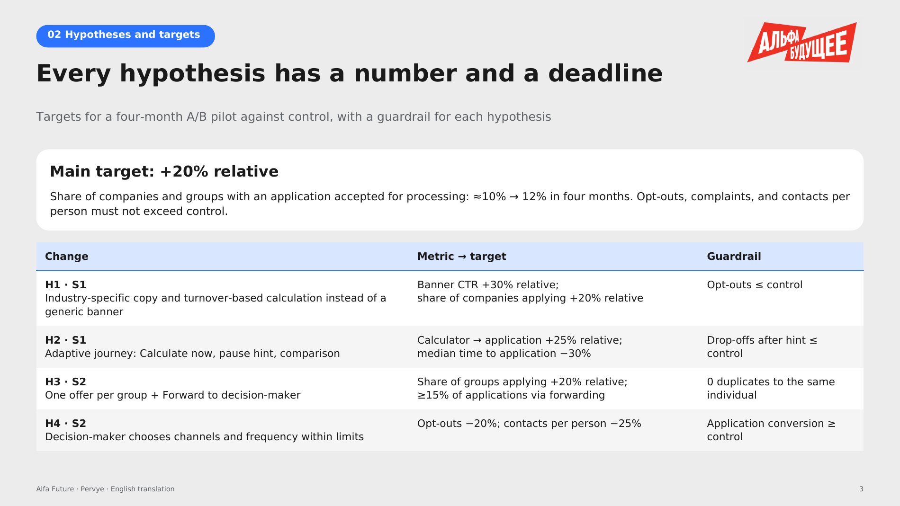
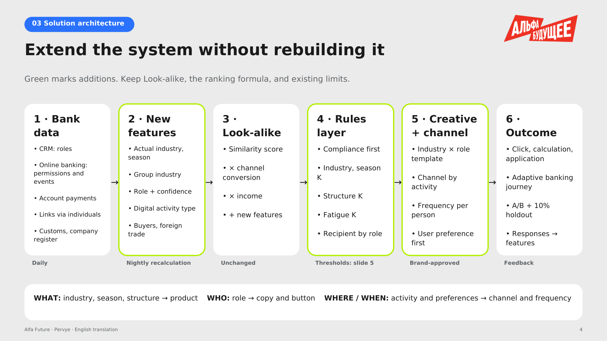
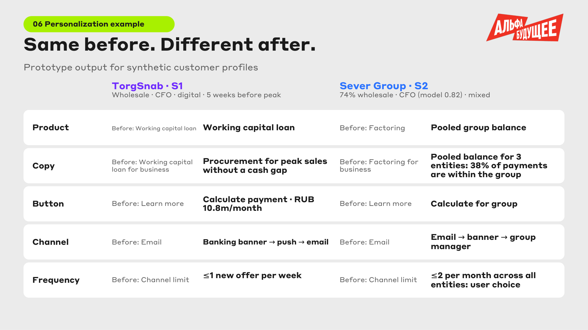
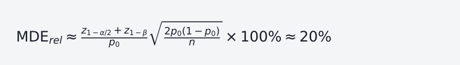

<h1>
  
  
  Alfa Future — personalized banking offers for business
</h1>

[↩ Applied projects](https://github.com/levg00/levg00/blob/main/portfolio/applied.en.md)

A concept for extending Alfa-Bank's ML optimizer: selecting a banking offer, copy, channel, and message frequency based on the company's business and the employee's role.

🏆 **Final round of the Alfa Future case school**, team **Pervye**.

### 🖥️ [Open prototype](https://levg00.github.io/alfa-bank-personalization/en/) · 📄 [Final presentation](materials/presentation.en.pdf) · 📊 [Calculations](analysis/README.en.md)

## 🎯 Task

Adapt banking offers to the company's industry, the employee's role, and the business structure. Propose an application journey that responds to user actions and integrate the solution into the existing optimizer.

📋 [Case brief](materials/brief.en.pdf)

## ⚡ My contribution

- **Product work:** worked on segments, hypotheses, personalization scenarios, and a hypothesis validation plan. Extended the logic of the Look-alike marketing optimizer.
- **Analytics:** analyzed the customer base, payment relationships, and group structures to generate hypotheses.
- **Prototype:** built an interface prototype for personalized offers and an adaptive application journey.

## 💡 Team solution

Keep the current ML optimizer and use customer data analysis to add rules that tailor the offer to each customer.

| What we consider | How the offer changes |
| :--- | :--- |
| What the company does and what its payments look like | Offer a working capital loan to a wholesaler with seasonal procurement needs; consider factoring for one highly dependent on major buyers |
| Who opens the offer | Show the CFO a calculation and an application button; let the accountant prepare an application and forward it to the decision-maker |
| Whether the company is standalone or part of a group | Select a product for the standalone company's needs; for a group, consider balances and payments across several legal entities |
| How the user interacts with the bank and responds to offers | Show an online banking banner to an active user; use a manager contact for someone who prefers personal communication. Pause after two impressions without a response |

<b>📊 Hypotheses and the new ML optimizer architecture</b>

### Hypotheses and targets

### Solution architecture

## 🖥️ What the result looks like

**Comparison of two scenarios:** the CFO of a standalone company receives an offer tailored to procurement. The CFO of a group receives an offer for managing pooled balances across several legal entities.

**In the prototype:** four synthetic profiles, a before/after comparison, an explanation of the selection, and an adaptive application journey.

### 🖥️ [Open prototype](https://levg00.github.io/alfa-bank-personalization/en/)

### What to try in the prototype

- Change the industry, employee role, and business structure → compare the offer and its explanation.
- Select an unknown role → see neutral copy.
- Switch from a company to a group → see the group scenario and a different contact policy.
- Open the adaptive journey tab → try going straight to a calculation, comparing products, and forwarding to the decision-maker.

The prototype runs in a browser using HTML, CSS, and JavaScript.

## 📊 Analytics

| What I did | Findings |
| :--- | :--- |
| Split trading customers into standalone companies and corporate groups | **80.3%** belong to groups; two personalization scenarios were identified |
| Checked wholesalers' dependence on their largest buyers | For most, more than **70%** of receipts come from just three buyers. This supports the hypothesis of offering factoring. |
| Checked how much money companies transfer within their group | For **28.9%** of companies, more than one fifth of outgoing payments go to other group members. We proposed managing these companies' balances and transfers together. |
| Identified each group's leading industry from its members' revenue | In **89.9%** of trading groups, one industry contributes at least half of known revenue. This is a feature for industry-specific personalization |

## 🧪 How we validate the effect

**Four-month pilot plan:** randomly assign standalone companies and corporate groups to three arms. All legal entities in the same corporate group remain in the same arm.

| Arm | Share | What the customer receives |
| :--- | :--- | :--- |
| Treatment | 45% | Personalized offers and an adaptive application journey |
| Control | 45% | Offers from the current optimizer and the existing journey |
| No messages | 10% | No marketing messages as part of the pilot |

**We compare treatment and control** by the share of companies and groups with an application accepted for processing, and by median time to application. The no-message group allows us to estimate organic conversion and understand how many additional applications personalization generates.

**Pilot targets:** increase the share of companies and groups with an accepted application by **20% relative to control**. Complaints, opt-outs, and contacts per person must not exceed control levels.

### Why the target is around +20%

**MDE is the smallest conversion increase the test can detect with the chosen level of reliability.** It depends on the sample size and baseline conversion.

<b>Calculation</b>

- **Baseline conversion (p₀ = 10%).** The assumed share of companies and groups completing the target action. An estimate of 10% was used for the calculation.
- **Size of each group (n = 3,561).** This is the number of participants assigned to each of the control and treatment arms. It was calculated as 45% of the total available base of 7,915 companies and groups.
- **Protection against a false alarm (α = 5%).** The significance level. This is the acceptable risk of detecting an effect when there is none. We choose a 5% false-positive threshold over repeated experiments.
- **Test sensitivity (1 − β = 80%).** Statistical power. If the changes produce an effect of the calculated size, the test should detect it with 80% probability under the calculation's assumptions. The remaining 20% (β = 0.20) is the acceptable risk of missing a real effect.
- **Statistical coefficients (z₁₋α/₂ ≈ 1.96 and z₁₋β ≈ 0.84).** These are tabulated multipliers from the normal distribution (quantiles). They were calculated in Python using the standard `statistics` module and its `NormalDist().inv_cdf` function. For the first coefficient, we use 1 − α/2 = 0.975 because we split the error risk between an increase and a decrease in conversion. For the second, we use power 1 − β = 0.80.

## 📂 Materials

- [Team's final presentation](materials/presentation.en.pdf)
- [Interactive prototype](https://levg00.github.io/alfa-bank-personalization/en/)
- [Code, metrics, and calculation methodology](analysis/README.en.md)
- [Final case brief](materials/brief.en.pdf)
