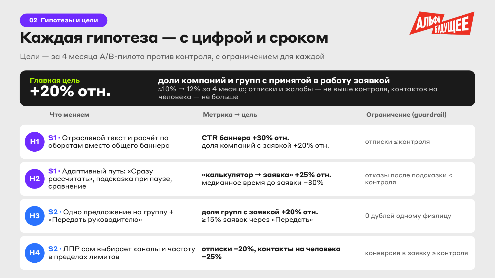
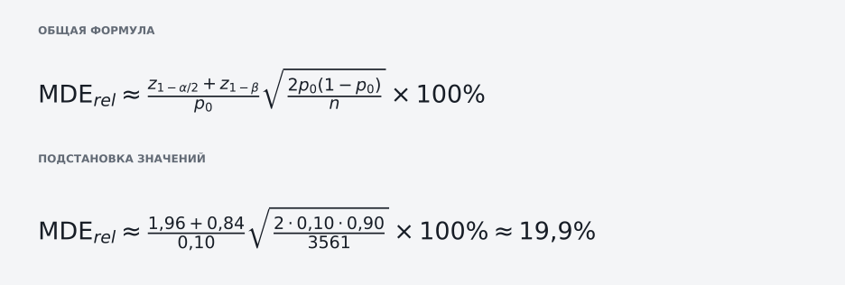

<h1>
  
  
  Альфа-Будущее — персонализация предложений для бизнеса
</h1>

[↩ Прикладные проекты](https://github.com/levg00/levg00/blob/main/portfolio/applied.ru.md)

Концепция доработки ML-оптимизатора Альфа-Банка: выбор банковского предложения, текста, канала и частоты сообщений с учётом бизнеса компании и роли сотрудника.

🏆 **Финал кейс-школы «Альфа-Будущее»**, команда **«Первые»**.

### 🖥️ [Открыть прототип](https://levg00.github.io/alfa-bank-personalization/) · 📄 [Финальная презентация](materials/presentation.ru.pdf) · 📊 [Расчёты](analysis/)

## 🎯 Задача

Адаптировать банковское предложение под отрасль компании, роль сотрудника и структуру бизнеса. Предложить путь до заявки, который реагирует на действия пользователя, и встроить решение в существующий оптимизатор.

📋 [Условие кейса](materials/brief.ru.pdf)

## ⚡ Мой вклад

- **Продуктовая часть:** работал над сегментами, гипотезами, сценариями персонализации и планом проверки гипотез. Дорабатывал логику маркетингового Look-alike оптимизатора.
- **Аналитика:** анализировал клиентскую базу, платёжные связи и структуру групп для генерации гипотез.
- **Прототип:** собирал прототип интерфейса персонализированных предложений и адаптивного пути до заявки.

## 💡 Решение команды

Сохраняем текущий ML-оптимизатор и на основе исследования данных о клиентах добавляем правила, которые меняют предложение под конкретного клиента.

| Что учитываем | Как меняется предложение |
| :--- | :--- |
| Чем занимается компания и какие у неё платежи | Оптовику с сезонными закупками предлагаем оборотный кредит, а с высокой зависимостью от крупных покупателей рассматриваем факторинг |
| Кто открыл предложение | Финдиректору показываем расчёт и кнопку подачи заявки, бухгалтеру даём подготовить заявку и передать руководителю |
| Работает компания самостоятельно или входит в группу | Для самостоятельной компании подбираем продукт под её задачи, для группы учитываем остатки и платежи нескольких юрлиц |
| Как пользователь работает с банком и реагирует на предложения | Активному пользователю показываем баннер в интернет-банке, предпочитающему личное общение предлагаем контакт через менеджера. После двух показов без реакции делаем паузу |

<b>📊 Гипотезы и новая архитектура ML-оптимизатора</b>

### Гипотезы и цели

### Схема решения

## 🖥️ Как выглядит результат

**Сравнение двух сценариев:** финансовому директору самостоятельной компании — предложение под закупки. Финансовому директору группы — управление общими остатками нескольких юрлиц.

**В прототипе:** четыре синтетических профиля, сравнение «было / стало», объяснение выбора и адаптивный путь до заявки.

### 🖥️ [Открыть прототип](https://levg00.github.io/alfa-bank-personalization/) 

### Что можно проверить в прототипе

- Переключить отрасль, роль сотрудника и структуру бизнеса → сравнить предложение и его объяснение.
- Выбрать неизвестную роль → увидеть нейтральную версию текста.
- Переключить компанию на группу → увидеть групповой сценарий и другую контактную политику.
- Открыть вкладку адаптивного пути → протестировать переход сразу к расчёту, сравнение продуктов и передачу руководителю.

Прототип работает в браузере на HTML, CSS и JavaScript.

## 📊 Аналитика

| Что сделал | Выводы |
| :--- | :--- |
| Разделил торговых клиентов на самостоятельные компании и холдинги | **80,3%** входят в группы, выделены два сценария персонализации |
| Проверил зависимость оптовиков от крупнейших покупателей | У большинства более **70%** поступлений приходится всего на трёх покупателей. Это основа для гипотезы о предложении факторинга. |
| Проверил, сколько денег компании переводят внутри своей группы | У **28,9%** компаний более пятой части исходящих платежей идёт другим участникам группы. Предложили объединить управление остатками и переводами этих компаний. |
| Определил ведущую отрасль группы по выручке участников | У **89,9%** торговых групп одна отрасль даёт не менее половины известной выручки. Это признак для персонализации по конкретной отрасли |

## 🧪 Как проверяем эффект

**План пилота на четыре месяца:** случайно распределить самостоятельные компании и группы компаний по трём веткам. Все юрлица одного холдинга остаются в одной ветке.

| Ветка | Доля | Что получает клиент |
| :--- | :--- | :--- |
| Тест | 45% | Персонализированные предложения и адаптивный путь до заявки |
| Контроль | 45% | Предложения текущего оптимизатора и существующий путь |
| Без сообщений | 10% | Не получает маркетинговые сообщения в рамках пилота |

**Тест и контроль сравниваем** по доле компаний и групп с заявкой, принятой в работу, и медианному времени до заявки. Группа без сообщений позволяет оценить органическую конверсию и понять, сколько дополнительных заявок приносит персонализация.

**Цели пилота:** увеличить долю компаний и групп с принятой заявкой на **20% относительно контроля**. Жалобы, отписки и число контактов на человека не должны превышать показатели контроля.

### Почему цель около +20%

**MDE — минимальный рост конверсии, который тест способен заметить с выбранной надёжностью.** Он зависит от размера выборки и исходной конверсии.

<b>Расчёт</b>

**Что означают параметры**

- **Базовая конверсия (p₀ = 0,10).** Предполагаемая доля компаний и групп с заявкой, принятой в работу. В исходных данных нет истории заявок, поэтому 10% использованы как допущение для планирования.
- **Размер каждой ветки (n = 3 561).** В выборке 1 994 самостоятельные компании и 5 921 группа, всего 7 915 единиц распределения. На тест и контроль выделяем по 45%: 7 915 × 0,45 = 3 561,75. Округляем вниз, оставшиеся единицы относятся к ветке без сообщений.
- **Уровень значимости (α = 0,05).** Выбираем допустимый риск ложного обнаружения эффекта: если реального изменения нет, правило проверки ошибочно покажет отличие примерно в 5% повторений эксперимента.
- **Мощность (1 − β = 0,80).** Выбираем вероятность обнаружить эффект рассчитанного размера: примерно в 8 из 10 повторений эксперимента. β = 0,20 соответствует риску его пропустить.
- **Коэффициент z₁₋α/₂.** В нормальном распределении ищем число, слева от которого находится доля 1 − 0,05 / 2 = 0,975. Получаем 1,95996, округляем до **1,96**. Риск делим на два, поскольку проверяем и рост, и падение; между −1,96 и +1,96 находится 95% распределения.
- **Коэффициент z₁₋β.** В том же распределении ищем число, слева от которого находится доля 1 − 0,20 = 0,80. Получаем 0,84162, округляем до **0,84**. Этот коэффициент задаёт дополнительный запас к порогу проверки, необходимый для выбранной мощности.

Оба коэффициента получены из стандартного нормального распределения, которое используем для описания случайных колебаний разницы конверсий при большой выборке. В англоязычной записи Excel их можно проверить функциями `NORM.S.INV(0.975)` и `NORM.S.INV(0.80)`.

**Итог расчёта: MDE ≈ 20% относительного роста.** Это соответствует увеличению конверсии с 10% примерно до 12% и даёт ориентир **около +20%** для планирования пилота. Расчёт использует нормальное приближение; перед запуском нужно уточнить фактическую базовую конверсию.

## 📂 Материалы

- [Финальная презентация команды](materials/presentation.ru.pdf).
- [Интерактивный прототип](https://levg00.github.io/alfa-bank-personalization/).
- [Код, показатели и методика расчётов](analysis/).
- [Условие финального кейса](materials/brief.ru.pdf).
