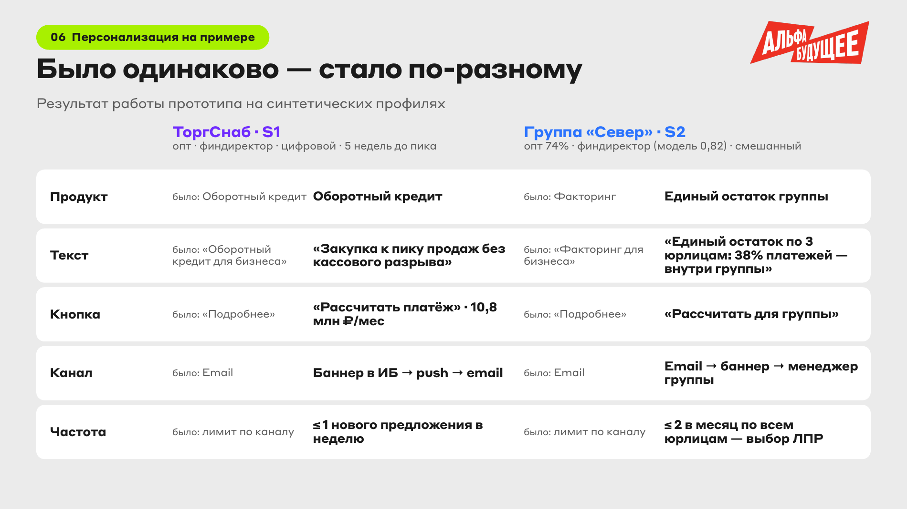
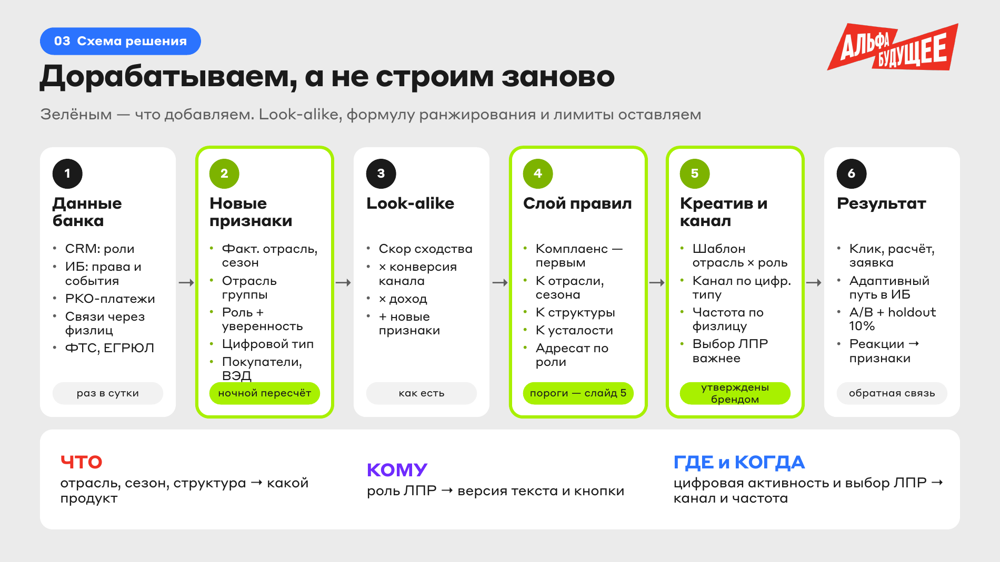

# Альфа-Будущее — персонализация предложений для бизнеса

[↩ Прикладные проекты](https://github.com/levg00/levg00/blob/main/portfolio/applied.ru.md)

Концепция доработки ML-оптимизатора Альфа-Банка: выбор банковского предложения, текста, канала и частоты сообщений с учётом бизнеса компании и роли сотрудника.

🏆 **Финал кейс-школы «Альфа-Будущее»**, команда **«Первые»**.

#### 🖥️ [Открыть прототип](https://levg00.github.io/alfa-bank-personalization/) · 📄 [Финальная презентация](materials/presentation.ru.pdf) · 📊 [Расчёты](analysis/)

## 🎯 Задача

Адаптировать банковское предложение под отрасль компании, роль сотрудника и структуру бизнеса. Предложить путь до заявки, который реагирует на действия пользователя, и встроить решение в существующий оптимизатор.

📋 [Условие кейса](materials/brief.ru.pdf)

## ⚡ Мой вклад

- **Продуктовая часть:** работал над сегментами, гипотезами, сценариями персонализации и планом проверки решения.
- **Аналитика:** участвовал в анализе клиентской базы, платёжных связей и структуры групп для обоснования концепции.
- **Прототип:** помогал собирать демонстрацию персонализированных предложений и адаптивного пути до заявки.

## 💡 Решение команды

Сохранить текущий ML-оптимизатор и дополнить его контекстом клиента и правилами персонализации.

| Что учитываем | Что меняется |
| :--- | :--- |
| Отрасль и потребности компании | Продукт и аргумент предложения |
| Роль сотрудника | Текст и действие: принять решение или подготовить и передать |
| Структура группы компаний | Предложение для отдельного юрлица или всей группы |
| Активность и реакция пользователя | Канал, частота сообщений и следующий шаг в интерфейсе |

## 🖥️ Как это выглядит

**Два сценария:** финансовому директору самостоятельной компании — предложение под закупки; финансовому директору группы — управление общими остатками нескольких юрлиц.

**В прототипе:** четыре синтетических профиля, сравнение «было / стало», объяснение выбора и адаптивный путь до заявки.

<b>Что можно проверить в прототипе</b>

- Переключить отрасль, роль сотрудника и структуру бизнеса — сравнить предложение и его объяснение.
- Выбрать неизвестную роль — увидеть нейтральную версию текста.
- Переключить компанию на группу — увидеть групповой сценарий и другую контактную политику.
- Открыть вкладку адаптивного пути — попробовать переход сразу к расчёту, сравнение продуктов и передачу руководителю.

Прототип работает в браузере на HTML, CSS и JavaScript. Он демонстрирует сценарии на условных профилях; банковские модели и данные к нему не подключены.

[Как открыть демо](docs/README.md)

## 📊 Аналитическое обоснование

В расчётном приложении выделены **10 147 торговых клиентов**: **1 994 самостоятельные компании** и **8 153 юрлица в 5 921 группе**. Для этих сегментов предложены разные сценарии персонализации.

<b>Данные, расчёты и сверка с презентацией</b>

- Использованы четыре таблицы: профили компаний, платежи, связи с физлицами и продукты.
- Рассчитаны 20 показателей с числителями, знаменателями и источниками.
- Воспроизводимый анализ выполнен на Python с Pandas и NumPy.
- В расчётах учтены неоднозначные идентификаторы и переводы компании самой себе.
- Аналитическое приложение добавлено после материалов защиты. Часть чисел презентации уточнена; различия сохранены в [сверке](analysis/presentation-reconciliation.csv).
- Повторный запуск воспроизвёл файлы `metrics.csv` и `results.json` без изменений.

[Методика и запуск расчётов](analysis/README.md)

## 🧪 Как планировали проверить эффект

**A/B-пилот:** новая персонализация против текущего оптимизатора; отдельная группа без исследуемых маркетинговых сообщений. Компании одного холдинга назначаются в одну ветку теста.

**Цели пилота:** +20% к доле компаний и групп с принятой заявкой и −30% к времени до заявки. Ограничения — отсутствие роста жалоб, отписок и числа контактов.

Это план проверки, а не измеренный результат внедрения. Реальный результат проекта — выход в финал, концепция и интерактивная демонстрация решения.

<b>Схема решения и инструменты</b>

- **Прототип:** HTML, CSS, JavaScript.
- **Расчётное приложение:** Python, Pandas, NumPy; CSV и JSON.
- **Методы:** Сегментация клиентов, Продуктовые гипотезы, Персонализация, Пользовательские сценарии, Планирование A/B-теста.

## 📂 Материалы

- [Финальная презентация команды](materials/presentation.ru.pdf).
- [Интерактивный прототип — файлы и запуск](docs/).
- [Код, показатели и методика расчётов](analysis/).
- [Условие финального кейса](materials/brief.ru.pdf).
