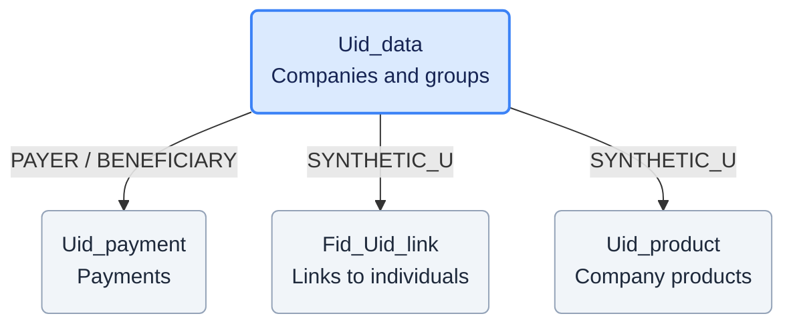

# Data structure

[↩ Back to the project](../README.md) · [Calculations](../analysis/README.md)

The case uses four CSV tables. This file describes the database structure.

## Tables

| Table | Contents |
| :--- | :--- |
| `Uid_data.csv` | Company profiles, industries, revenue, groups, and product flags |
| `Uid_payment.csv` | Amounts and counts of payments between companies |
| `Fid_Uid_link.csv` | Links between individuals and companies |
| `Uid_product.csv` | Company product records |

## Relationships

- **A company** is linked to payments, individuals, and products through `SYNTHETIC_U`.
- **A corporate group** contains profile records with the same `GROUP_ID`.
- **An individual** can be linked to several companies. A company can also have several linked individuals.

The profile table contains repeated `SYNTHETIC_U` values. When joining profiles to payments, the code excludes IDs that match multiple profiles.

## Table fields

<b>Company profiles — Uid_data.csv</b>

| Field | Contents |
| :--- | :--- |
| `SYNTHETIC_U` | Company ID |
| `ORG_TYPE` | Organization type |
| `OKFS_NAME` | Form of ownership |
| `OGRN_DATE` | OGRN registration date |
| `ECO_MARK_LABEL` | Business development stage |
| `MAINOKVED_CODE` | Primary business activity code |
| `MAINOKVED_NAME` | Primary business activity name |
| `NEGATIVEMARK` | Presence of a key owner, as defined in the case data dictionary |
| `AMOUNT_WORKERS_SPARK` | Employee count according to SPARK |
| `AMOUNT_WORKERS_FNS` | Employee count according to the Federal Tax Service |
| `CL_TYPE` | Current or prospective customer |
| `CL_PRODUCT_RKO_MARK` | Settlement and cash services flag |
| `CL_PRODUCT_GAR_MARK` | Bank guarantee flag |
| `CL_PRODUCT_LOA_MARK` | Loan flag |
| `CL_PRODUCT_LEA_MARK` | Leasing flag |
| `CL_PRODUCT_DEP_MARK` | Deposit flag |
| `CL_PRODUCT_ZPP_MARK` | Payroll services flag |
| `FTS_FLAG` | Flag indicating presence in the Federal Customs Service database |
| `FTS_COUNTRY_NAME` | Country from the Federal Customs Service database |
| `FACTORING_MARK` | Factoring flag |
| `REVENUE_COMPANY` | Annual company revenue |
| `REVENUE_GROUP` | Annual group revenue |
| `GROUP_ID` | Group ID |
| `CITY` | City |
| `REGION` | Region |

<b>Payments — Uid_payment.csv</b>

| Field | Contents |
| :--- | :--- |
| `PAYER` | Payer company ID |
| `BENEFICIARY` | Recipient company ID |
| `PAY_AMT` | Total payment amount |
| `PAY_CNT` | Payment count |

Each row contains aggregated payments between a payer and a recipient. The table contains no payment dates.

<b>Links to individuals — Fid_Uid_link.csv</b>

| Field | Contents |
| :--- | :--- |
| `SYNTHETIC_F` | Individual ID |
| `SYNTHETIC_U` | Linked company ID |
| `CITY_NAME` | Individual's city |
| `RC_NAME` | Individual's region |

A link to a company does not identify the person's job title, permissions, or decision-making role. The table contains no such fields.

<b>Company products — Uid_product.csv</b>

| Field | Contents |
| :--- | :--- |
| `SYNTHETIC_U` | Company ID |
| `PRODUCT` | Product name |

The table contains only the company and product. It has no application dates, statuses, or communication outcomes.

