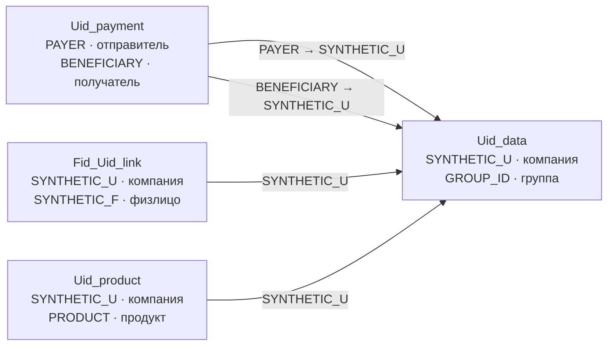

# Структура данных

[↩ К проекту](../README.ru.md) · [Расчёты](../analysis/README.md)

В кейсе использованы четыре CSV-таблицы. Здесь описаны их поля и связи. Исходные записи не опубликованы.

## Таблицы

| Таблица | Содержание | Для чего использована |
| :--- | :--- | :--- |
| `Uid_data.csv` | Профили компаний, отрасли, выручка, группы и продуктовые флаги | Отбор клиентов, сегменты S1/S2, состав и ведущая отрасль группы |
| `Uid_payment.csv` | Суммы и количество платежей между компаниями | Концентрация поступлений, внутригрупповые переводы и крупнейшие получатели |
| `Fid_Uid_link.csv` | Связи физлиц с компаниями | Покрытие компаний связями и число компаний, связанных с одним физлицом |
| `Uid_product.csv` | Записи о продуктах компаний | Проверка наличия продукта ВЭД |

## Связи

- **Компания** связывается с платежами, физлицами и продуктами через `SYNTHETIC_U`.
- **Группа компаний** объединяет записи профилей с одинаковым `GROUP_ID`.
- **Физлицо** может быть связано с несколькими компаниями, а компания — с несколькими физлицами.

Это связи между выгрузками, а не ограничения SQL-базы. Уникальность `SYNTHETIC_U` в таблице профилей не гарантирована. При объединении с платежами код исключает идентификаторы, которым соответствуют несколько профилей.

## Поля таблиц

<b>Профили компаний — Uid_data.csv</b>

| Поле | Содержание |
| :--- | :--- |
| `SYNTHETIC_U` | Идентификатор компании |
| `ORG_TYPE` | Тип организации |
| `OKFS_NAME` | Форма собственности |
| `OGRN_DATE` | Дата регистрации ОГРН |
| `ECO_MARK_LABEL` | Стадия развития бизнеса |
| `MAINOKVED_CODE` | Код основного вида деятельности |
| `MAINOKVED_NAME` | Название основного вида деятельности |
| `NEGATIVEMARK` | Наличие ключевого собственника по словарю кейса |
| `AMOUNT_WORKERS_SPARK` | Численность сотрудников по данным СПАРК |
| `AMOUNT_WORKERS_FNS` | Численность сотрудников по данным ФНС |
| `CL_TYPE` | Действующий или потенциальный клиент |
| `CL_PRODUCT_RKO_MARK` | Флаг расчётно-кассового обслуживания |
| `CL_PRODUCT_GAR_MARK` | Флаг банковской гарантии |
| `CL_PRODUCT_LOA_MARK` | Флаг кредита |
| `CL_PRODUCT_LEA_MARK` | Флаг лизинга |
| `CL_PRODUCT_DEP_MARK` | Флаг депозита |
| `CL_PRODUCT_ZPP_MARK` | Флаг зарплатного проекта |
| `FTS_FLAG` | Флаг присутствия в базе ФТС |
| `FTS_COUNTRY_NAME` | Страна из базы ФТС |
| `FACTORING_MARK` | Флаг факторинга |
| `REVENUE_COMPANY` | Годовая выручка компании |
| `REVENUE_GROUP` | Годовая выручка группы |
| `GROUP_ID` | Идентификатор группы |
| `CITY` | Город |
| `REGION` | Регион |

<b>Платежи — Uid_payment.csv</b>

| Поле | Содержание |
| :--- | :--- |
| `PAYER` | Идентификатор компании-отправителя |
| `BENEFICIARY` | Идентификатор компании-получателя |
| `PAY_AMT` | Сумма платежей |
| `PAY_CNT` | Количество платежей |

Строка содержит агрегированные платежи между отправителем и получателем. Дат платежей в таблице нет.

<b>Связи с физлицами — Fid_Uid_link.csv</b>

| Поле | Содержание |
| :--- | :--- |
| `SYNTHETIC_F` | Идентификатор физлица |
| `SYNTHETIC_U` | Идентификатор связанной компании |
| `CITY_NAME` | Город физлица |
| `RC_NAME` | Регион физлица |

Связь с компанией не определяет должность, права или роль человека в принятии решения. Таких полей в таблице нет.

<b>Продукты компаний — Uid_product.csv</b>

| Поле | Содержание |
| :--- | :--- |
| `SYNTHETIC_U` | Идентификатор компании |
| `PRODUCT` | Название продукта |

Таблица содержит только компанию и продукт. Дат заявок, их статусов и результатов коммуникаций в ней нет.

## Формат файлов

CSV с разделителем `;`, кодировкой `cp1251` и десятичной запятой. Названия полей выше соответствуют заголовкам исходных CSV; их регистр сохранён.
